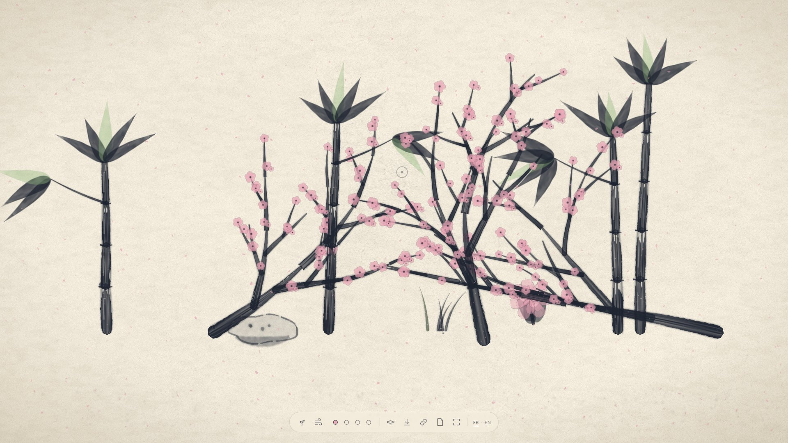
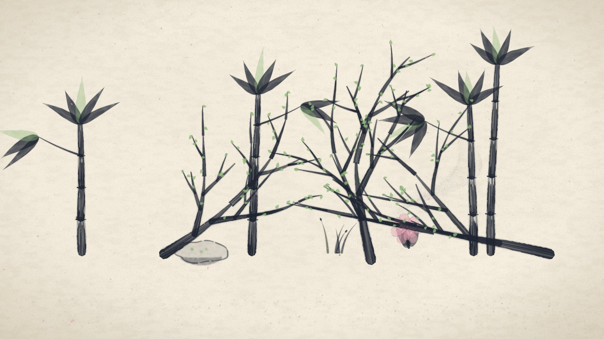
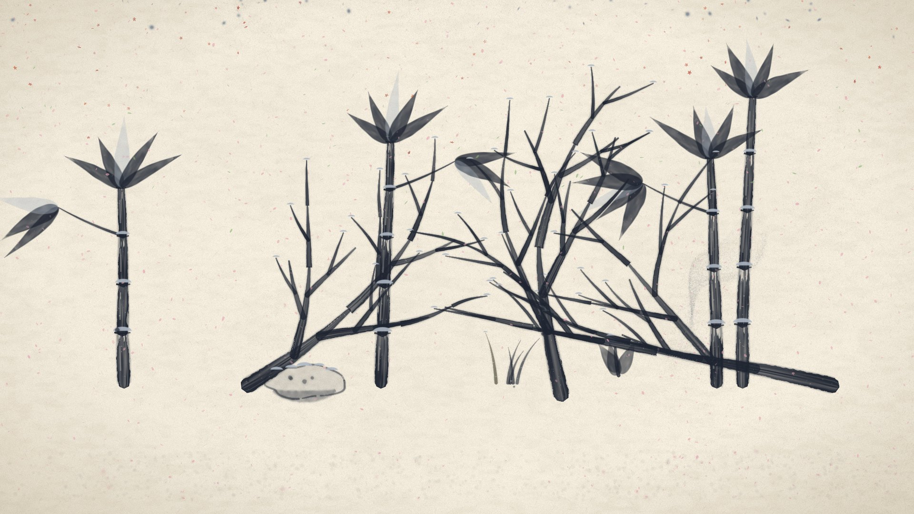

<div align="center">

# 庭 sumi-niwa

### Jardin d'encre — un jardin sumi-e qui pousse sous ta souris

*Un papier washi, de l'encre noir bleuté, quatre saisons. Tu plantes, tu souffles, le jardin vit.*
*A living ink garden in your browser: plant, blow the wind, let the seasons turn.*

**[▶ Ouvrir le jardin](https://MalikChopa.github.io/sumi-niwa/)** · [Architecture](docs/ARCHITECTURE.md) · [Spécification](docs/SPEC.md) · [English summary](#english-summary)



</div>

---

## Ce que c'est

**sumi-niwa** (*sumi* = encre, *niwa* = jardin) est un jardin génératif en temps réel, dans le navigateur, rendu avec **WebGPU**. Une feuille de papier washi, un pinceau, et un jardin à l'encre qui pousse trait après trait : l'encre s'étale dans les fibres du papier puis sèche, le vent suit ton curseur, des pétales et des feuilles tombent et laissent leur tache. Pas de menu à apprendre, pas de compte, pas de serveur : une page statique.

Projet de portfolio, pensé pour qu'une capture d'écran soit présentable sans retouche.

<table>
<tr>
<td></td>
<td></td>
<td></td>
</tr>
<tr>
<td align="center"><sub>Été</sub></td>
<td align="center"><sub>Automne</sub></td>
<td align="center"><sub>Hiver</sub></td>
</tr>
</table>

## Jouer

| Geste | Effet |
|---|---|
| **Clic** | une graine d'encre, puis une plante de l'espèce courante pousse |
| **Maintien** | une jauge choisit l'espèce selon la durée : bambou, branche de cerisier, herbes, pivoine, roche |
| **Bouger la souris** | du vent sous le curseur : tiges qui ondulent, brume d'encre et pétales emportés |
| **S** (ou les 4 points de la barre, ou la molette) | change de saison ; transition douce de moins de 4 s |
| **P** — *Garder ce jardin* | exporte un PNG de 3840 × 2160, sans interface |
| **L** — *Copier le lien* | le lien rouvre les mêmes plantes, à l'identique |
| **N** — *Nouvelle feuille* | repart d'une feuille vide (confirmation si le jardin est riche ; Précédent le ramène) |
| **M** | ambiance sonore générative (coupée par défaut) |
| **C** | mode contemplatif : l'interface disparaît, le jardin pousse seul (aussi après 90 s d'inactivité en plein écran) |
| **Q** | qualité manuelle (sinon, elle s'adapte toute seule) |
| **F** | plein écran |

Tout se fait aussi **au clavier** : flèches pour déplacer un pinceau, Entrée pour planter, 1 à 5 pour l'espèce, Espace pour mettre le temps en pause.

## Sous le capot

- **Plantes déterministes.** Chaque plante naît d'une graine (générateur sfc32, trigonométrie par polynômes : aucun appel `Math.sin`, vérifié par un test de garde). Le lien contient la graine et la liste des plantations : les **mêmes plantes** reviennent sur n'importe quelle machine. Les taches laissées par les particules, elles, peuvent varier légèrement.
- **Pinceau.** Chaque trait est un ruban effilé, aux bords irréguliers, révélé progressivement : pression variable, pinceau sec, frange humide.
- **Encre.** Une grille 2D calculée sur le GPU (compute shaders, `rgba16float`) fait diffuser l'encre humide le long des fibres du papier, puis sécher.
- **Particules.** Jusqu'à **200 000 particules** en compute : une brume d'encre fine portée par le vent, et quelques milliers de pétales et feuilles visibles qui tachent le papier en tombant.
- **Qualité adaptative.** Quatre paliers (15 000 à 200 000 particules) et un contrôleur qui monte ou descend selon le temps d'image, avec hystérésis.
- **Papier.** Entièrement procédural (shader) : fibres, grain, vignette et une légère respiration de la lumière.
- **Son.** Synthétisé dans le navigateur avec Web Audio (vent filtré, gouttes, notes pentatoniques) : aucun fichier audio, rien avant ton premier clic.
- **Trois niveaux, jamais d'écran blanc.** WebGPU complet ; version réduite en WebGL2 (sans diffusion d'encre, moins de particules) ; sinon un message clair en français et en anglais, y compris sans JavaScript.
- **Léger et privé.** Une seule page statique d'environ **0,9 Mo** décompressés (0,26 Mo compressés). Ni cookie, ni traceur, ni appel réseau.

Le détail est dans [`docs/ARCHITECTURE.md`](docs/ARCHITECTURE.md) et [`docs/SPEC.md`](docs/SPEC.md).

## Performances — ce qui est mesuré, et ce qui ne l'est pas

Sur une machine de développement (AMD RDNA 3, Edge 156, WebGPU matériel, fenêtre 2552 × 1354) :

| Palier | Particules | Images/s (médiane) | GPU par image |
|---|---|---|---|
| Élevé | 200 000 | 59,9 | 1,05 ms |
| Moyen | 100 000 | 59,9 | 0,76 ms |
| Bas | 40 000 | 59,9 | 0,54 ms |
| Minimal | 15 000 | 59,9 | 0,43 ms |

Honnêtement : **un seul passage, sur une seule machine** ; la cadence est plafonnée à 60 images/s et le banc d'essai rend dans un canvas d'environ 950 × 995 pixels, pas dans un plein écran 1080p. Ce sont des mesures, pas une promesse. Les chiffres « sans fenêtre » des tests automatiques sont indicatifs.

## Compatibilité

Testé : **Edge et Chrome 156 sous Windows**. WebGPU est annoncé par le wiki d'implémentation de la spécification dans Chrome et Edge (version 113+), Firefox sous Windows (141+) et Safari 26 ([source](https://github.com/gpuweb/gpuweb/wiki/Implementation-Status), relevée le 2026-11-01), mais **Safari, Firefox, le tactile et les lecteurs d'écran n'ont pas été essayés avec ce projet**. Sans WebGPU, la version réduite WebGL2 prend le relais ; sans rien, un message l'explique. WebGPU exige HTTPS (ou `localhost`).

## Lancer en local

```bash
npm install
npm run dev          # http://localhost:4180/
npm run build        # production dans dist/
npm run preview      # sert dist/ sur http://localhost:4181/
```

Prérequis : Node 22 et un navigateur récent. Paramètres d'URL de démonstration : `?quality=T3|T2|T1|T0` (force un palier), `?force=complet|reduit|refus` (force un niveau).

## Tests

```bash
npm run typecheck    # TypeScript strict
npm run test:unit    # Vitest : déterminisme, garde Math, bornes, PRNG, URL, contrôleur de qualité, ...
npm run test         # Playwright dans Edge : construit une version de test, puis ~90 tests de bout en bout
npm run size-report  # poids de dist/ face à l'objectif de 2 Mo
npm run bench        # banc d'essai des paliers de qualité (fenêtre Edge)
```

La version de production ne contient **aucun crochet de test** (vérifié par un scan à chaque build).

## Licence et crédits

Code et rendu : **© 2026 MalikChopa — tous droits réservés.** Le dépôt est public pour être lu et essayé ; il n'est pas placé sous licence libre, donc ni copie ni réutilisation sans accord.

Composants tiers livrés avec la page : [three.js](https://threejs.org) (MIT, texte dans `LICENSES.txt` généré au build). Voir [`THIRD_PARTY.md`](THIRD_PARTY.md). Aucune police, image ni son tiers. Inspirations (jamais copiées) : la peinture sumi-e, le jardin zen, et les jardins génératifs en WebGPU.

---

## English summary

**sumi-niwa** is a real-time generative sumi-e ink garden that runs in the browser on **WebGPU** (Three.js, TypeScript, Vite). Click to plant (hold to choose among bamboo, cherry branch, grasses, peony, rock), move the mouse to blow the wind, press **S** to change season, **P** to export a 3840 × 2160 PNG with no interface, **L** to copy a link that reopens the *same plants*, **M** for a synthesized ambience, **C** for a self-growing contemplative mode.

Plants are generated deterministically from a seed; ink diffusion and up to 200,000 particles run in compute shaders with an adaptive quality controller; paper, sound and strokes are all procedural. The whole site is one static page of about 0.9 MB with no cookies, no tracker and no network call, and it degrades to WebGL2, then to a clear message — never a blank screen.

Measured on one AMD RDNA 3 machine in Edge 156: 200,000 particles at 59.9 fps (single run, frame rate capped at 60). Tested on Edge and Chrome under Windows only; Safari, Firefox, touch and screen readers are untested. The interface is in French and English. All rights reserved: the source is public to read, not to reuse.
